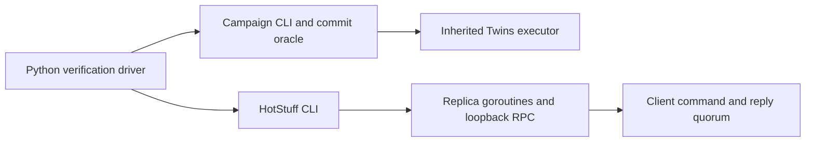
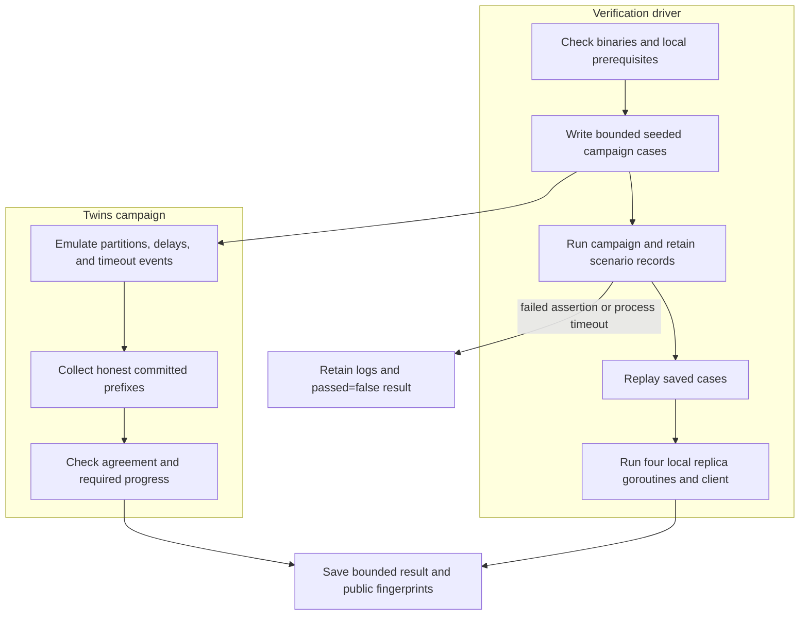

# HotStuff consensus engine

## Contents

- [Architecture and execution guide](#architecture-and-execution-guide)
- [Run locally](#run-locally)
- [Evidence and limits](#evidence-and-limits)
- [Validation notes](docs/validation.md)

The [frozen native benchmark](.agents/skills/verify-hotstuff/features/benchmark.md) uses the real TLS/ECDSA CLI, opt-in bounded raw command observations, replica/payload/client/concurrency cells repeated five times, stability checks at offered rates and native CPU profiles. `python tools/benchmark.py smoke` checks exact raw outcomes and replica execution agreement; `benchmark` and `profile` require isolated Linux. `isolation` preserves the known round-robin zero-progress failure as a diagnostic with `progress_passed: false`. No consensus safety rule changed. Safe exported metrics exclude ephemeral private keys present in upstream network option records. The [hosted result audit](docs/benchmark-results.md) records that all 35 trials passed correctness checks, while the sustained 300/s SLO and permanent replica-isolation liveness check failed. The profile is diagnostic and does not establish capacity or an SLO fix. At 100 offered commands/s, the four-replica baseline finished 99.7/s with arrival-to-finish p99 33.184 ms, median of five runs [32.925, 33.266 ms]. At 300/s for 120 seconds, 35,448 of 36,000 planned commands finished, 547 were undispatched, and p99 reached 1,840.748 ms. These are one-process loopback replica goroutines, not multi-host capacity results.

A local adversarial workbench around the complete MIT-licensed [relab/hotstuff](https://github.com/relab/hotstuff) framework. It retains the upstream chained HotStuff, Fast HotStuff, Simple HotStuff, ECDSA/EdDSA/BLS crypto, Gorums networking, pacemaker, block fetch, clients and Twins executor. The added campaign saves exact partition scenarios, checks every overlapping honest commit prefix, rejects vacuous recovery, and replays failures.

This adaptation is inspired by Stanford CS244b's [HotStuff capstone report](https://www.scs.stanford.edu/24sp-cs244b/projects/HotStuff_Implementation_and_Advice.pdf), using a reusable framework rather than copying unlicensed student code. The algorithms and Twins framework are inherited. Read [provenance](docs/provenance.md), the unchanged [license](LICENSE), and the preserved [upstream README](docs/README.upstream.md).

## Architecture and execution guide

The inherited `relab/hotstuff` framework implements consensus protocols, cryptography, Gorums networking, leader rotation, clients, and the Twins simulator. This repository adds a bounded campaign, evidence oracle, exact scenario replay, and local product driver. Twins replicas are simulated participants; the network journey uses four replica goroutines and loopback sockets inside one process.

This boundary map separates the actual product paths used by the verification driver.



The campaign CLI explores simulated partitions and checks committed histories. The local HotStuff CLI starts replicas and a client over loopback. Both paths reuse inherited consensus, certificate, and client code; neither represents multiple operating-system replica processes.

This sequence shows how campaign cases, replay, and the real loopback journey produce separate evidence.



The oracle requires agreement on overlapping honest commit prefixes and non-vacuous progress in journeys designated to make progress. No quorum requires zero commits. A finite campaign tests these named cases; it does not prove universal safety or liveness. A failed run keeps its logs and failure verdict.

| Subsystem | Responsibility | Owned state or invariant | Source |
| --- | --- | --- | --- |
| Protocol core | Coordinate proposal, votes, certificates, and commit rules | Protocol view and certified block chain | [`core/replica.go`](core/replica.go), [`hotstuff.go`](hotstuff.go) |
| Event loop | Serialize replica events and timeout processing | Per-replica event queue and lifecycle | [`core/eventloop/eventloop.go`](core/eventloop/eventloop.go) |
| Twins and protocol modules | Emulate partitions and compose consensus components | Scenario-defined network conditions and simulated participants | [`twins`](twins), [`protocol`](protocol) |
| CLI orchestration | Parse config and run local or configured workers | Local worker choice and bounded run settings | [`internal/cli/run.go`](internal/cli/run.go) |
| Client | Send commands and wait for `f+1` replies | Client sequence, pending commands, and bounded concurrency | [`client/client.go`](client/client.go) |
| Campaign oracle | Check commit agreement, progress, and replay | Honest identities, committed hashes/views, and pass criteria | [`cmd/campaign/main.go`](cmd/campaign/main.go) |

Terms used in these paths: [HotStuff](#concept-hotstuff), [replicas](#concept-replica), [views](#concept-view), [quorum certificates](#concept-quorum-certificate), [pacemaker](#concept-pacemaker), [Twins](#concept-twins), [honest committed prefixes](#concept-honest-prefix), and [liveness](#concept-liveness).

### Follow one verification run

1. Build the inherited HotStuff binary and the campaign binary, then run the Python driver with a fresh evidence directory.
2. The driver checks local prerequisites and writes a bounded set of seeded cases. Each case records a partition scenario and one twin identity.
3. The campaign runs each case in the inherited Twins executor. The oracle compares honest commit prefixes, checks quorum requirements, and rejects empty progress where progress is expected.
4. The driver replays saved scenarios, then starts the local network journey with four replica goroutines, TLS loopback connections, and one client.
5. The client waits for replies from `f+1` replicas. Repeating the same client sequence must not change the command count; a new sequence must execute.
6. The driver stores scenario records, logs, command results, and public-key fingerprints. Timeouts or failed assertions produce `passed:false` and preserve evidence.

### Design decisions and limits

These rationales are inferred from the current implementation. They do not record historic design intent.

| Choice | Practical rationale | Alternative and cost | Reconsider when |
| --- | --- | --- | --- |
| Reuse the inherited consensus framework | Keeps the campaign focused on behavior evidence and preserves upstream implementations | A fresh implementation would duplicate protocol and cryptographic code | The goal becomes implementing a protocol variant itself |
| Use Twins for adversarial schedules | Repeats named partitions and timeouts without remote hosts | Real multi-process or multi-host faults are more realistic but add deployment and environment dependencies | Process failure or network stack behavior is the question |
| Require agreement and non-vacuous progress | Prevents a safety-only or empty-progress run from passing | Weaker checks are easier to satisfy but could bless vacuous outcomes | The journey's contract changes and the oracle is updated with it |
| Keep the network journey loopback and in one process | Exercises actual RPC and client paths without SSH or deployment | Separate processes test crash boundaries but need owned process and storage lifecycle | Restart durability or process isolation becomes required |
| Preserve the failed round-robin isolation case | Reports a known no-progress condition instead of hiding it | Changing leadership behavior might improve that scenario but changes the tested schedule | A protocol change is independently justified and retested |

### Glossary

<a id="concept-hotstuff"></a>

<details><summary>What is HotStuff?</summary>

HotStuff is a Byzantine fault-tolerant consensus protocol. This repository preserves chained, Fast, and Simple HotStuff variants; the workbench does not replace their consensus rules.
</details>

<a id="concept-replica"></a>

<details><summary>What is a replica?</summary>

A replica is a participant that processes proposals and votes. In the local network journey, four replicas are goroutines in one process rather than four separate processes.
</details>

<a id="concept-view"></a>

<details><summary>What is a view?</summary>

A view is a protocol round associated with a leader and proposal progress. The isolation evidence tracks commit hashes and views to detect gaps in consecutive-view certified chains.
</details>

<a id="concept-quorum-certificate"></a>

<details><summary>What is a quorum certificate?</summary>

A quorum certificate (QC) aggregates sufficient replica votes for a block or event. The campaign records signer counts and checks certificate views; this evidence does not prove every certificate path correct.
</details>

<a id="concept-pacemaker"></a>

<details><summary>What is a pacemaker?</summary>

A pacemaker coordinates view changes and proposal timing. It is inherited from the framework; emulated timeout events drive it in Twins journeys.
</details>

<a id="concept-twins"></a>

<details><summary>What is Twins?</summary>

Twins is an executor for emulating Byzantine participants and network schedules. The campaign caps cases, views, and ticks so the run remains bounded.
</details>

<a id="concept-honest-prefix"></a>

<details><summary>What is an honest committed prefix?</summary>

It is the ordered sequence of commands committed by a replica that is not the designated twin. The oracle requires overlapping prefixes from honest replicas to agree.
</details>

<a id="concept-liveness"></a>

<details><summary>What is liveness?</summary>

Liveness is progress toward committing commands. The permanent replica-1 isolation journey passes only with a stable honest leader; the inherited round-robin schedule did not progress within 300 ticks.
</details>

## Run locally

Use Go 1.27.3 and Python 3. No cloud, SSH server, Docker, GPU or protobuf regeneration is needed.

```powershell
$env:GOTOOLCHAIN='local'
$env:CGO_ENABLED='0'
$env:GOMAXPROCS='2'
go build -p 2 -o scratch/hotstuff.exe ./cmd/hotstuff
go build -p 2 -o scratch/campaign.exe ./cmd/campaign
python tools/verify.py --hotstuff scratch/hotstuff.exe --campaign scratch/campaign.exe --output scratch/proof
go test -p 2 -timeout 3m ./...
go vet -p 2 ./...
```

Use a fresh evidence directory. The Python driver runs doctor, 17 bounded Twins journeys, replay, and a three-second four-replica/one-client network run. It records commands, exit codes, logs, measurements and passed=false on failure. It supplies empty local config files so user SSH/configuration is never used. The empty SSH file satisfies the inherited local runner's parser; no remote hosts are contacted. Each subprocess has a 45-second deadline.

```powershell
scratch/campaign.exe -input scratch/proof/campaign/scenarios.json -output scratch/replay
```

Campaign inputs are capped at 69 cases, 40 views per case and 300 emulation ticks. Seeded cases have one twin identity and two partitions. Controlled journeys cover healthy progress, initial leader isolation/healing, permanent isolation of replica 1 while the three honest replicas progress, twin partition/healing, and no progress without quorum. Results contain honest commit hashes/views, QC participant counts and ephemeral public-key fingerprints. Private keys stay in memory. Upstream map scheduling, timestamps and keys vary, so scenario replay does not promise byte-identical traces.

## Evidence and limits

The [verification skill](.agents/skills/verify-hotstuff/SKILL.md) and feature map are the maintained entry point. [Validation notes](docs/validation.md) record reproduced defects and evidence. The adapter validates distinct certificate signers and QC views, rejects malformed certificates, binds verification-cache entries to signer identities and message contents, initializes the emulated timeout countdown, and adds focused regressions, an intentionally conflicting commit-oracle control, and duplicate client execution checks.

The local runner uses four replica goroutines and real loopback sockets in one process. Twins emulates networking. Neither is a four-process crash experiment. Client commands carry IDs and sequence numbers but are not application-signed; network runs use TLS and replica QCs use ECDSA. ClientIO suppresses repeated execution by sequence number. There is no persistent anti-double-voting or restart recovery. Storage is an in-memory block cache. A bounded campaign is evidence for these journeys, not a universal BFT proof or performance benchmark. Partitions are indexed by each sender's effective view; recovery assertions cover the explicit one-view isolation/healing journey.

Permanent replica 1 isolation with round-robin leaders did not commit within 300 ticks in the controlled experiment. The inherited protocol collects votes at the next leader and requires consecutive-view certified chains. The passing permanent-isolation journey therefore switches to stable honest leader 2 after the initial failed leader. It does not establish liveness for arbitrary leader schedules. This limitation is retained in the validation notes.

The [message-trace audit](docs/benchmark-results.md#liveness-and-evidence-limits) identifies lost view-4 votes and the resulting certificate gaps. It matches a known limitation of chained HotStuff under four-replica round-robin leadership; no safety condition was removed to make the diagnostic pass.

The dependency fix moves gRPC 1.78 to 1.84 and updates affected x/net, x/crypto, x/image and x/text modules to fixed versions. Original workflow files remain inactive under docs/upstream-workflows. CI runs bounded read-only local checks.
