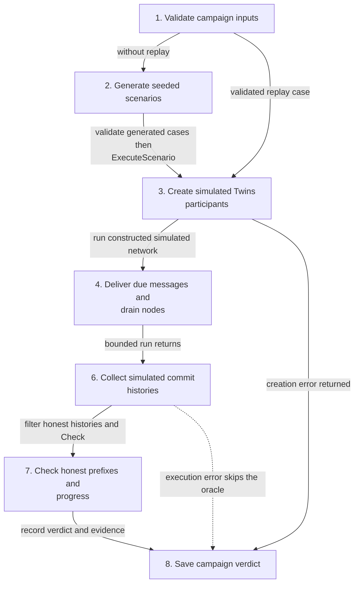
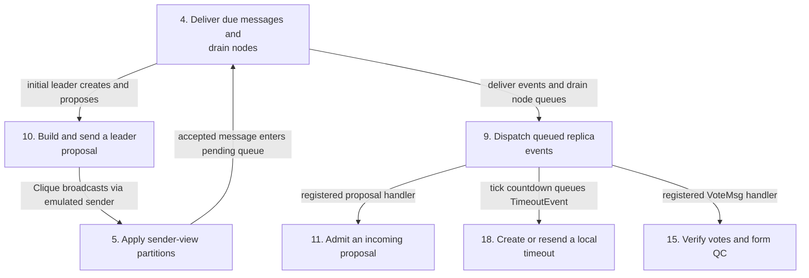
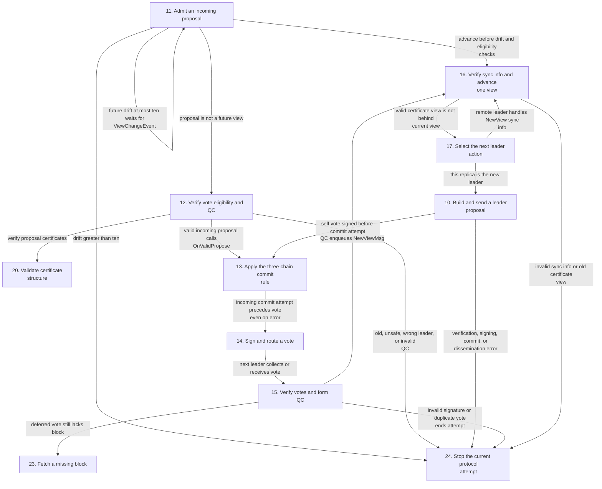
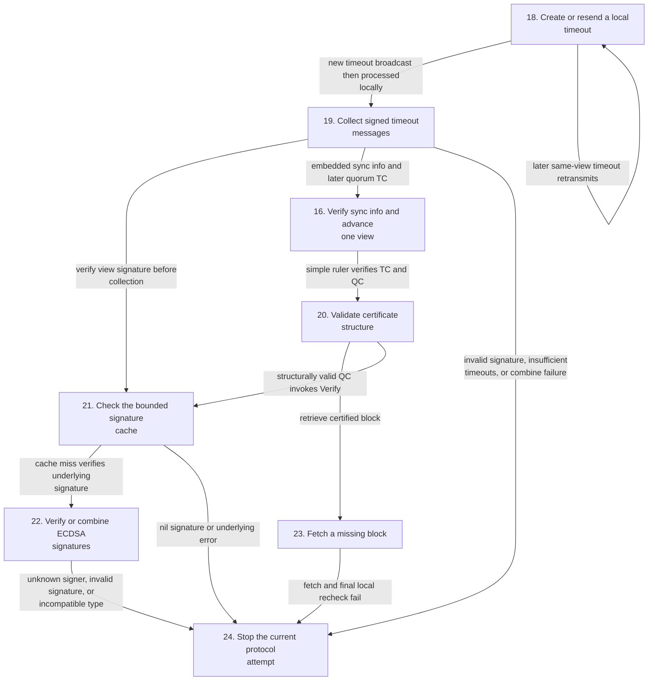
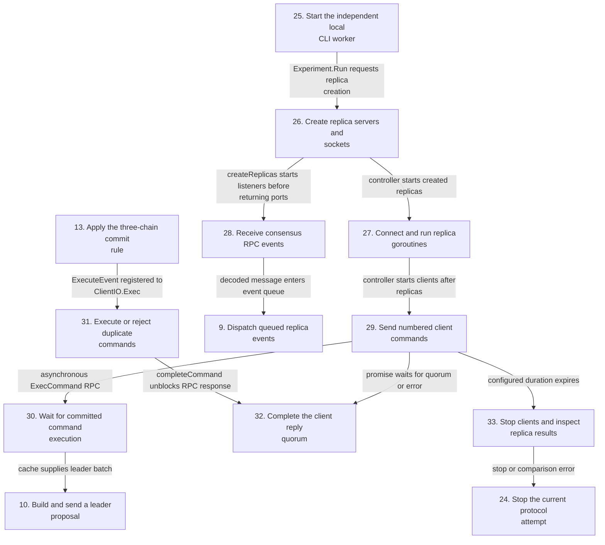
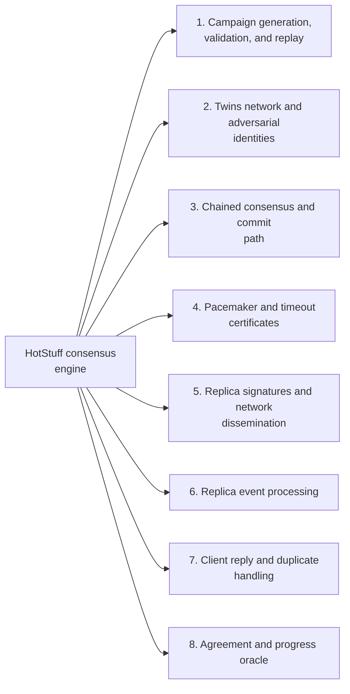
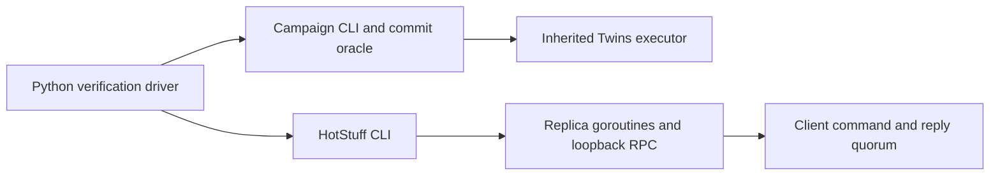
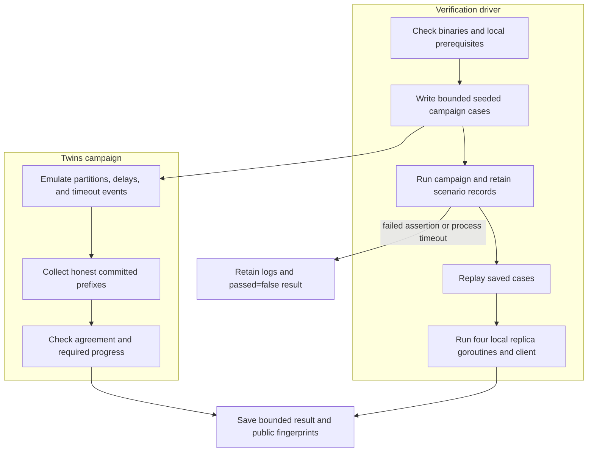

# HotStuff consensus engine

## Contents

- [Architecture and execution guide](#architecture-and-execution-guide)
- [Run locally](#run-locally)
- [Evidence and limits](#evidence-and-limits)
- [Implementation techniques](#implementation-techniques)
- [Validation notes](docs/validation.md)

The [frozen native benchmark](.agents/skills/verify-hotstuff/features/benchmark.md) uses the real TLS/ECDSA CLI, opt-in bounded raw command observations, replica/payload/client/concurrency cells repeated five times, stability checks at offered rates and native CPU profiles. `python tools/benchmark.py smoke` checks exact raw outcomes and replica execution agreement; `benchmark` and `profile` require isolated Linux. `isolation` preserves the known round-robin zero-progress failure as a diagnostic with `progress_passed: false`. No consensus safety rule changed. Safe exported metrics exclude ephemeral private keys present in upstream network option records. The [hosted result audit](docs/benchmark-results.md) records that all 35 trials passed correctness checks, while the sustained 300/s SLO and permanent replica-isolation liveness check failed. The profile is diagnostic and does not establish capacity or an SLO fix. At 100 offered commands/s, the four-replica baseline finished 99.7/s with arrival-to-finish p99 33.184 ms, median of five runs [32.925, 33.266 ms]. At 300/s for 120 seconds, 35,448 of 36,000 planned commands finished, 547 were undispatched, and p99 reached 1,840.748 ms. These are one-process loopback replica goroutines, not multi-host capacity results.

A local adversarial workbench around the complete MIT-licensed [relab/hotstuff](https://github.com/relab/hotstuff) framework. It retains the upstream chained HotStuff, Fast HotStuff, Simple HotStuff, ECDSA/EdDSA/BLS crypto, Gorums networking, pacemaker, block fetch, clients and Twins executor. The added campaign saves exact partition scenarios, checks every overlapping honest commit prefix, rejects vacuous recovery, and replays failures.

This adaptation is inspired by Stanford CS244b's [HotStuff capstone report](https://www.scs.stanford.edu/24sp-cs244b/projects/HotStuff_Implementation_and_Advice.pdf), using a reusable framework rather than copying unlicensed student code. The algorithms and Twins framework are inherited. Read [provenance](docs/provenance.md), the unchanged [license](LICENSE), and the preserved [upstream README](docs/README.upstream.md).

## Architecture and execution guide

<!-- execution-flow:start -->
### Execution flow

Start with the primary path, then expand a detailed workflow. Select a numbered node to see its operation, implementation techniques, and source. Solid arrows show the named control, data, or lifecycle handoff; dotted arrows show error paths. Separate entry points are named in each workflow.

<a id="review-walkthrough"></a>

#### Walk through one concrete example

A replica receives a correctly signed proposal for the next view whose QC and linked ancestors are available locally.

**Trace.** [Build and send a leader proposal](#flow-step-proposal) → [Apply the three-chain commit rule](#flow-step-commit) → [Sign and route a vote](#flow-step-vote) → [Verify votes and form QC](#flow-step-votes) → [Verify sync info and advance one view](#flow-step-advance) → [Select the next leader action](#flow-step-newview).

**Result and boundary.** The replica attempts the three-chain commit, signs and routes its vote, and advances when it receives a quorum certificate. Committing requires linked consecutive-view ancestors; missing ancestors return an error, and the flow does not promise general recovery.

<details>
<summary>Implementation decisions to explain</summary>

**Why commit from a three-chain of certified blocks instead of committing every valid proposal?** The rule commits an ancestor only after the required chain of linked certificates, giving the protocol an explicit safety condition. The tradeoff is that a missing ancestor blocks that commit attempt even while the replica can continue voting.

[Three-chain certified commit rule](#technique-three-chain-certified-commit) · [Distinct-signer quorum certificate validation](#technique-quorum-certificate-validation).

</details>

#### Primary execution flow

Campaign generation or saved replay runs bounded Twins consensus and checks honest commit prefixes. The native local CLI has an independent entrypoint.



**Detailed workflows.** [Twins delivery and event dispatch](#flow-workflow-simulated-network) · [Proposal, vote, QC, and commit](#flow-workflow-chained-consensus) · [Certificate checks and timeout advancement](#flow-workflow-certificates-timeouts) · [Independent local RPC and client execution](#flow-workflow-local-rpc-client).

<a id="flow-workflow-simulated-network"></a>

<details>
<summary>Twins delivery and event dispatch</summary>

Verification simulation queues messages and drains node event loops. It does not start the local RPC CLI.



</details>

<a id="flow-workflow-chained-consensus"></a>

<details>
<summary>Proposal, vote, QC, and commit</summary>

Shared chained protocol. Incoming proposals attempt commit before signing; outgoing proposals sign before commit. Errors stop their current attempt.



</details>

<a id="flow-workflow-certificates-timeouts"></a>

<details>
<summary>Certificate checks and timeout advancement</summary>

Shared cache, ECDSA, fetch, and pacemaker calls. Cache hits return to callers. Timeout collection follows the retained slice implementation without a general liveness guarantee.



</details>

<a id="flow-workflow-local-rpc-client"></a>

<details>
<summary>Independent local RPC and client execution</summary>

The documented native journey uses a worker and replica goroutines in one process. Shared consensus appears in its own detailed workflow.



</details>

#### Steps, techniques, and source

These source traces cover the active scope below. They explain implementation behavior; benchmark results and their limits remain in the measurement sections.

<a id="flow-step-campaign"></a>

##### 1. Validate campaign inputs

**Component.** cmd/campaign. Require a fresh output directory and write passed=false first. Replay accepts at most 2 MiB and 1..69 cases; each case validates identities, partitions, leaders, and scenario bounds before execution.

**Techniques at this step.** [Bounded exact scenario replay](#technique-bounded-exact-scenario-replay).

**Source.** [`cmd/campaign/main.go:33`](https://github.com/STEVVVU/hotstuff-consensus-engine/blob/main/cmd/campaign/main.go#L33). [Back to execution flow](#execution-flow).

<a id="flow-step-generate"></a>

##### 2. Generate seeded scenarios

**Component.** twins.Generator. Without replay, append five controlled cases and shuffle a four-replica, one-twin partition generator with the requested seed. NextScenario advances a bounded Cartesian enumeration, with seeded offsets.

**Techniques at this step.** [Seeded partition scenario generation](#technique-seeded-partition-scenario-generation).

**Source.** [`twins/generator.go:111`](https://github.com/STEVVVU/hotstuff-consensus-engine/blob/main/twins/generator.go#L111). [Back to execution flow](#execution-flow).

<a id="flow-step-simulate"></a>

##### 3. Create simulated Twins participants

**Component.** twins.Network. ExecuteScenario selects chained HotStuff and 300 ticks. Distinct network NodeIDs sharing a ReplicaID reuse a private key; each node has its own protocol state, synchronous vote verification, 100-entry certificate cache, and preloaded commands.

**Techniques at this step.** [Shared-key twin equivocation simulation](#technique-shared-key-twin-equivocation) · [Bounded exact scenario replay](#technique-bounded-exact-scenario-replay).

**Source.** [`twins/network.go:119`](https://github.com/STEVVVU/hotstuff-consensus-engine/blob/main/twins/network.go#L119) · [`twins/node.go:45`](https://github.com/STEVVVU/hotstuff-consensus-engine/blob/main/twins/node.go#L45). [Back to execution flow](#execution-flow).

<a id="flow-step-tick"></a>

##### 4. Deliver due messages and drain nodes

**Component.** twins.Network. Kick off initial leader proposals. Each tick first delivers pending messages whose effective view is no greater than globalView, then adds a tick event and drains each node queue. If nothing was delivered globalView increments; execution stops at the tick bound or network error.

**Techniques at this step.** [Discrete-time event simulation](#technique-discrete-time-event-simulation).

**Source.** [`twins/network.go:181`](https://github.com/STEVVVU/hotstuff-consensus-engine/blob/main/twins/network.go#L181). [Back to execution flow](#execution-flow).

<a id="flow-step-partition"></a>

##### 5. Apply sender-view partitions

**Component.** twins.emulatedSender. For each destination twin, use the sender's effective view to drop configured message types across partitions or queue a message for a later tick. ExecuteScenario includes proposals, votes, block hashes, NewView messages, and timeout messages in dropTypes, despite its stale comment.

**Techniques at this step.** [View-indexed message partitioning](#technique-view-indexed-message-partitioning).

**Source.** [`twins/sender.go:41`](https://github.com/STEVVVU/hotstuff-consensus-engine/blob/main/twins/sender.go#L41) · [`twins/scenario.go:57`](https://github.com/STEVVVU/hotstuff-consensus-engine/blob/main/twins/scenario.go#L57). [Back to execution flow](#execution-flow).

<a id="flow-step-collect"></a>

##### 6. Collect simulated commit histories

**Component.** twins.ExecuteScenario. CommitEvent handlers append executed blocks per node. After the bounded run, collect histories, public-key fingerprints, and network logs and run the inherited commit comparison.

**Techniques at this step.** [Honest-prefix agreement and nonvacuous progress checks](#technique-honest-prefix-agreement-and-nonvacuous-progress).

**Source.** [`twins/scenario.go:73`](https://github.com/STEVVVU/hotstuff-consensus-engine/blob/main/twins/scenario.go#L73). [Back to execution flow](#execution-flow).

<a id="flow-step-oracle"></a>

##### 7. Check honest prefixes and progress

**Component.** workbench.Check. Exclude twins and the configured faulty identity. Require minimum commits where configured, increasing views, at least three QC participants when QCView is nonzero, and matching hashes at every overlapping index. The no-quorum case additionally rejects any commit.

**Techniques at this step.** [Honest-prefix agreement and nonvacuous progress checks](#technique-honest-prefix-agreement-and-nonvacuous-progress).

**Source.** [`workbench/oracle.go:13`](https://github.com/STEVVVU/hotstuff-consensus-engine/blob/main/workbench/oracle.go#L13). [Back to execution flow](#execution-flow).

<a id="flow-step-save"></a>

##### 8. Save campaign verdict

**Component.** cmd/campaign. Write each network log and results.json. Any execution or oracle error sets passed=false and exits 1; only successful completion replaces status.json with passed=true. Input and file errors panic.

**Techniques at this step.** [Bounded exact scenario replay](#technique-bounded-exact-scenario-replay).

**Source.** [`cmd/campaign/main.go:112`](https://github.com/STEVVVU/hotstuff-consensus-engine/blob/main/cmd/campaign/main.go#L112). [Back to execution flow](#execution-flow).

<a id="flow-step-dispatch"></a>

##### 9. Dispatch queued replica events

**Component.** core/eventloop. AddEvent executes explicitly opted-in immediate handlers and pushes to a bounded circular queue that drops its oldest entry when full. Tick or Run dispatches priority handlers before ordinary handlers and then releases events delayed on that event type.

**Techniques at this step.** [Serialized event dispatch with a bounded drop-oldest queue](#technique-serialized-event-dispatch-with-bounded-drop-oldest-queue).

**Source.** [`core/eventloop/eventloop.go:213`](https://github.com/STEVVVU/hotstuff-consensus-engine/blob/main/core/eventloop/eventloop.go#L213) · [`core/eventloop/queue.go:30`](https://github.com/STEVVVU/hotstuff-consensus-engine/blob/main/core/eventloop/queue.go#L30). [Back to execution flow](#execution-flow).

<a id="flow-step-proposal"></a>

##### 10. Build and send a leader proposal

**Component.** consensus.Proposer. CreateProposal marks certified commands proposed and waits for a batch under the timeout context. The chained rule requires a QC. Propose verifies, signs its own vote, attempts commit, then disseminates; any failure returns before later operations.

**Techniques at this step.** [ECDSA partial signatures and quorum aggregation](#technique-signed-quorum-certificate-aggregation) · [One-to-all proposals and votes to the next leader](#technique-one-to-all-vote-to-next-leader-dissemination).

**Source.** [`protocol/consensus/proposer.go:79`](https://github.com/STEVVVU/hotstuff-consensus-engine/blob/main/protocol/consensus/proposer.go#L79). [Back to execution flow](#execution-flow).

<a id="flow-step-receive"></a>

##### 11. Admit an incoming proposal

**Component.** synchronizer.Synchronizer. First attempt advanceView using the proposal QC. Drop proposals more than ten views ahead, delay smaller future drift until ViewChangeEvent, and verify the proposal before OnValidPropose.

**Techniques at this step.** [Distinct-signer quorum certificate validation](#technique-quorum-certificate-validation).

**Source.** [`protocol/synchronizer/synchronizer.go:96`](https://github.com/STEVVVU/hotstuff-consensus-engine/blob/main/protocol/synchronizer/synchronizer.go#L96). [Back to execution flow](#execution-flow).

<a id="flow-step-verify-proposal"></a>

##### 12. Verify vote eligibility and QC

**Component.** consensus.Voter. Reject a view no newer than lastVotedView. The chained rule requires a QC above the lock or extension of the lock, then VerifyAnyQC validates the QC and the voter checks the expected leader.

**Techniques at this step.** [Three-chain certified commit rule](#technique-three-chain-certified-commit) · [Distinct-signer quorum certificate validation](#technique-quorum-certificate-validation).

**Source.** [`protocol/consensus/voter.go:96`](https://github.com/STEVVVU/hotstuff-consensus-engine/blob/main/protocol/consensus/voter.go#L96) · [`protocol/rules/chainedhotstuff.go:87`](https://github.com/STEVVVU/hotstuff-consensus-engine/blob/main/protocol/rules/chainedhotstuff.go#L87). [Back to execution flow](#execution-flow).

<a id="flow-step-commit"></a>

##### 13. Apply the three-chain commit rule

**Component.** consensus.Committer. Store the proposal, follow three QC references, update the lock at the second, and require linked parents with consecutive views before selecting the third ancestor. Recursively commit ancestors first, enqueue CommitEvent and ExecuteEvent before publishing CommittedBlock, and emit AbortEvent for pruned forks. Missing ancestors return errors.

**Techniques at this step.** [Three-chain certified commit rule](#technique-three-chain-certified-commit).

**Source.** [`protocol/consensus/committer.go:44`](https://github.com/STEVVVU/hotstuff-consensus-engine/blob/main/protocol/consensus/committer.go#L44) · [`protocol/rules/chainedhotstuff.go:48`](https://github.com/STEVVVU/hotstuff-consensus-engine/blob/main/protocol/rules/chainedhotstuff.go#L48). [Back to execution flow](#execution-flow).

<a id="flow-step-vote"></a>

##### 14. Sign and route a vote

**Component.** consensus.Voter and comm.Clique. For incoming valid proposals, attempt commit before signing and still vote if commit failed. Update lastVotedView only after signing. Clique sends the vote to the next leader or collects locally when this replica is that leader; proposals broadcast before the proposer's vote is aggregated.

**Techniques at this step.** [ECDSA partial signatures and quorum aggregation](#technique-signed-quorum-certificate-aggregation) · [One-to-all proposals and votes to the next leader](#technique-one-to-all-vote-to-next-leader-dissemination).

**Source.** [`protocol/consensus/voter.go:52`](https://github.com/STEVVVU/hotstuff-consensus-engine/blob/main/protocol/consensus/voter.go#L52). [Back to execution flow](#execution-flow).

<a id="flow-step-votes"></a>

##### 15. Verify votes and form QC

**Component.** votingmachine.VotingMachine. Defer a vote with a local block miss until a proposal arrives, then fetch if still missing. Reject old blocks and invalid or duplicate signers. At quorum, combine partial signatures and enqueue NewViewMsg with the QC; verification runs inline for Twins and can run in a goroutine for native replicas.

**Techniques at this step.** [ECDSA partial signatures and quorum aggregation](#technique-signed-quorum-certificate-aggregation) · [Distinct-signer quorum certificate validation](#technique-quorum-certificate-validation).

**Source.** [`protocol/votingmachine/votingmachine.go:90`](https://github.com/STEVVVU/hotstuff-consensus-engine/blob/main/protocol/votingmachine/votingmachine.go#L90). [Back to execution flow](#execution-flow).

<a id="flow-step-advance"></a>

##### 16. Verify sync info and advance one view

**Component.** synchronizer.Synchronizer. Verify TC and QC, prefer QC when its view is at least TC's, and attempt HighQC update. Return for certificate views below the current view. Otherwise stop the timer, increment the local view once with NextView, reset timeout state, restart the timer, and enqueue ViewChangeEvent.

**Techniques at this step.** [Timeout-certificate view advancement](#technique-timeout-certificate-view-advancement).

**Source.** [`protocol/synchronizer/synchronizer.go:250`](https://github.com/STEVVVU/hotstuff-consensus-engine/blob/main/protocol/synchronizer/synchronizer.go#L250) · [`protocol/viewstates.go:92`](https://github.com/STEVVVU/hotstuff-consensus-engine/blob/main/protocol/viewstates.go#L92). [Back to execution flow](#execution-flow).

<a id="flow-step-newview"></a>

##### 17. Select the next leader action

**Component.** synchronizer.Synchronizer. After advancing, create and send a proposal if this replica is leader. Otherwise send NewView to the selected leader. Proposal construction, dissemination, and missing destination errors are logged without an invented retry.

**Techniques at this step.** [One-to-all proposals and votes to the next leader](#technique-one-to-all-vote-to-next-leader-dissemination).

**Source.** [`protocol/synchronizer/synchronizer.go:293`](https://github.com/STEVVVU/hotstuff-consensus-engine/blob/main/protocol/synchronizer/synchronizer.go#L293). [Back to execution flow](#execution-flow).

<a id="flow-step-timeout"></a>

##### 18. Create or resend a local timeout

**Component.** synchronizer.Synchronizer. Twins countdown emits TimeoutEvent every five ticks and raises effectiveView; native Start uses a one-shot wall-clock timer. A current-view timeout restarts the timer, resends an existing timeout or signs a new one, stops voting, broadcasts, and handles its own new timeout locally.

**Techniques at this step.** [Timeout-certificate view advancement](#technique-timeout-certificate-view-advancement) · [Discrete-time event simulation](#technique-discrete-time-event-simulation).

**Source.** [`protocol/synchronizer/synchronizer.go:182`](https://github.com/STEVVVU/hotstuff-consensus-engine/blob/main/protocol/synchronizer/synchronizer.go#L182). [Back to execution flow](#execution-flow).

<a id="flow-step-remote-timeout"></a>

##### 19. Collect signed timeout messages

**Component.** synchronizer.Synchronizer. Reject invalid view signatures, attempt advancement from embedded sync info, then add the timeout. The collector rejects a duplicate ID and view, but tests the total retained slice length for quorum and returns a clone before removing entries for the triggering view. The simple rule combines a TC and advances again with HighQC.

**Techniques at this step.** [Timeout-certificate view advancement](#technique-timeout-certificate-view-advancement).

**Source.** [`protocol/synchronizer/synchronizer.go:209`](https://github.com/STEVVVU/hotstuff-consensus-engine/blob/main/protocol/synchronizer/synchronizer.go#L209) · [`protocol/synchronizer/timeout_collector.go:22`](https://github.com/STEVVVU/hotstuff-consensus-engine/blob/main/protocol/synchronizer/timeout_collector.go#L22). [Back to execution flow](#execution-flow).

<a id="flow-step-qc"></a>

##### 20. Validate certificate structure

**Component.** cert.Authority. Genesis QC requires view zero. Other QCs require a nonnil signature, distinct participant quorum, a retrievable block, and matching QC and block views before cryptographic verification. Nonzero TCs require a nonnil distinct quorum signature over view bytes.

**Techniques at this step.** [Distinct-signer quorum certificate validation](#technique-quorum-certificate-validation).

**Source.** [`security/cert/auth.go:116`](https://github.com/STEVVVU/hotstuff-consensus-engine/blob/main/security/cert/auth.go#L116). [Back to execution flow](#execution-flow).

<a id="flow-step-cache"></a>

##### 21. Check the bounded signature cache

**Component.** cert.Cache. Key verification by message digest, signature bytes, and participant IDs. Hits update recency; misses invoke underlying verification and insert only success. Insertion evicts the least recently used entry at capacity. Combine is not cached.

**Techniques at this step.** [Bounded certificate verification cache](#technique-bounded-certificate-verification-cache).

**Source.** [`security/cert/cache.go:73`](https://github.com/STEVVVU/hotstuff-consensus-engine/blob/main/security/cert/cache.go#L73). [Back to execution flow](#execution-flow).

<a id="flow-step-ecdsa"></a>

##### 22. Verify or combine ECDSA signatures

**Component.** crypto.ECDSA. Sign hashes the message and uses ECDSA ASN.1 with the replica identity. Combine rejects overlapping signers and incompatible types. Verify checks each signer against configured public keys in goroutines and joins their errors.

**Techniques at this step.** [ECDSA partial signatures and quorum aggregation](#technique-signed-quorum-certificate-aggregation).

**Source.** [`security/crypto/ecdsa.go:96`](https://github.com/STEVVVU/hotstuff-consensus-engine/blob/main/security/crypto/ecdsa.go#L96). [Back to execution flow](#execution-flow).

<a id="flow-step-fetch"></a>

##### 23. Fetch a missing block

**Component.** blockchain.Blockchain. Get checks local storage, then requests a block under TimeoutContext while releasing its mutex. A concurrent Store cancels a pending fetch; on fetch failure Get checks local storage again. Twins searches reachable nodes directly; native RequestBlock accepts a reply only when its hash matches.

**Techniques at this step.** [View-indexed message partitioning](#technique-view-indexed-message-partitioning).

**Source.** [`security/blockchain/blockchain.go:99`](https://github.com/STEVVVU/hotstuff-consensus-engine/blob/main/security/blockchain/blockchain.go#L99) · [`twins/sender.go:117`](https://github.com/STEVVVU/hotstuff-consensus-engine/blob/main/twins/sender.go#L117) · [`network/sender.go:264`](https://github.com/STEVVVU/hotstuff-consensus-engine/blob/main/network/sender.go#L264). [Back to execution flow](#execution-flow).

<a id="flow-step-reject"></a>

##### 24. Stop the current protocol attempt

**Component.** protocol consensus and synchronizer. Invalid proposals, signatures, stale certificates, unavailable blocks, and failed signing or aggregation end the corresponding attempt or remain logged as specified by each caller. A failed incoming commit is accumulated while voting continues. No general recovery guarantee follows.

This handoff carries inputs, outputs, or failure state for the protocol operations described in adjacent steps.

**Source.** [`protocol/consensus/voter.go:52`](https://github.com/STEVVVU/hotstuff-consensus-engine/blob/main/protocol/consensus/voter.go#L52). [Back to execution flow](#execution-flow).

<a id="flow-step-local"></a>

##### 25. Start the independent local CLI worker

**Component.** internal/cli. With no remote hosts, runSingleExperiment creates a local worker goroutine over net.Pipe and invokes Experiment.Run. This path does not dispatch the campaign or Twins simulator.

**Techniques at this step.** [Loopback RPC replica execution](#technique-loopback-rpc-replica-execution).

**Source.** [`internal/cli/run.go:135`](https://github.com/STEVVVU/hotstuff-consensus-engine/blob/main/internal/cli/run.go#L135). [Back to execution flow](#execution-flow).

<a id="flow-step-servers"></a>

##### 26. Create replica servers and sockets

**Component.** orchestration.Worker. CreateReplica requests parse keys, configure ECDSA, security cache, chained rules, Clique and the pacemaker for this documented journey. Start replica and client RPC servers on ephemeral TCP listeners; listener, configuration, and key errors return through worker responses.

**Techniques at this step.** [Loopback RPC replica execution](#technique-loopback-rpc-replica-execution).

**Source.** [`internal/orchestration/worker.go:109`](https://github.com/STEVVVU/hotstuff-consensus-engine/blob/main/internal/orchestration/worker.go#L109). [Back to execution flow](#execution-flow).

<a id="flow-step-run-replicas"></a>

##### 27. Connect and run replica goroutines

**Component.** replica.Replica. The worker connects replica configurations before deferred starts. Replica.Start launches Run in a goroutine; Run starts the synchronizer then its event loop. Local replicas share one operating-system process and use loopback RPC addresses.

**Techniques at this step.** [Loopback RPC replica execution](#technique-loopback-rpc-replica-execution).

**Source.** [`replica/replica.go:136`](https://github.com/STEVVVU/hotstuff-consensus-engine/blob/main/replica/replica.go#L136). [Back to execution flow](#execution-flow).

<a id="flow-step-rpc"></a>

##### 28. Receive consensus RPC events

**Component.** server.serviceImpl. GorumsSender sends proposals and targeted votes or NewView messages. Server methods derive peer identity, decode protobuf messages, apply configured delay, and enqueue protocol events. Block fetch requests answer from local storage or return NotFound.

**Techniques at this step.** [Loopback RPC replica execution](#technique-loopback-rpc-replica-execution) · [One-to-all proposals and votes to the next leader](#technique-one-to-all-vote-to-next-leader-dissemination).

**Source.** [`server/server.go:116`](https://github.com/STEVVVU/hotstuff-consensus-engine/blob/main/server/server.go#L116). [Back to execution flow](#execution-flow).

<a id="flow-step-client"></a>

##### 29. Send numbered client commands

**Component.** client.Client. The worker connects and starts clients after replicas. sendCommands rate-limits input, assigns increasing sequence numbers, issues asynchronous ExecCommand with a timeout, and queues promises. EOF sends empty commands until the tracked final sequence completes.

**Techniques at this step.** [f+1 client reply quorum](#technique-f-plus-one-client-reply-quorum) · [Per-client monotone sequence deduplication](#technique-per-client-monotone-sequence-deduplication).

**Source.** [`client/client.go:198`](https://github.com/STEVVVU/hotstuff-consensus-engine/blob/main/client/client.go#L198). [Back to execution flow](#execution-flow).

<a id="flow-step-admit-command"></a>

##### 30. Wait for committed command execution

**Component.** server.ClientIO. ExecCommand stores a waiter by message ID, adds the command to the cache, releases the Gorums context, and waits on the completion channel. A leader's CreateProposal consumes batches from that cache.

**Techniques at this step.** [Per-client monotone sequence deduplication](#technique-per-client-monotone-sequence-deduplication).

**Source.** [`server/clientio.go:79`](https://github.com/STEVVVU/hotstuff-consensus-engine/blob/main/server/clientio.go#L79). [Back to execution flow](#execution-flow).

<a id="flow-step-execute"></a>

##### 31. Execute or reject duplicate commands

**Component.** server.ClientIO. ExecuteEvent invokes Exec. Under the mutex, reject a sequence no greater than that client's highest executed sequence with Aborted. Otherwise advance the sequence, hash command data, increment the count, and complete its waiter. AbortEvent completes forked commands with Aborted.

**Techniques at this step.** [Per-client monotone sequence deduplication](#technique-per-client-monotone-sequence-deduplication).

**Source.** [`server/clientio.go:93`](https://github.com/STEVVVU/hotstuff-consensus-engine/blob/main/server/clientio.go#L93). [Back to execution flow](#execution-flow).

<a id="flow-step-reply"></a>

##### 32. Complete the client reply quorum

**Component.** client.qspec. ExecCommandQF accepts replies from f+1 distinct reply-map entries. handleCommands waits on promises and records finished, failed, timed-out, or canceled outcomes. This client threshold is separate from the replica consensus quorum.

**Techniques at this step.** [f+1 client reply quorum](#technique-f-plus-one-client-reply-quorum).

**Source.** [`client/client.go:34`](https://github.com/STEVVVU/hotstuff-consensus-engine/blob/main/client/client.go#L34). [Back to execution flow](#execution-flow).

<a id="flow-step-shutdown"></a>

##### 33. Stop clients and inspect replica results

**Component.** orchestration.Experiment. After the configured duration, stop clients, wait five initial timeouts, stop replicas, and log counts and hashes. The controller compares hashes only within equal-count groups; the verification driver imposes the stronger identical nonzero count check. Replica.Stop cancels, waits for Run, and closes connections and servers.

**Techniques at this step.** [Loopback RPC replica execution](#technique-loopback-rpc-replica-execution).

**Source.** [`internal/orchestration/controller.go:69`](https://github.com/STEVVVU/hotstuff-consensus-engine/blob/main/internal/orchestration/controller.go#L69) · [`internal/orchestration/controller.go:234`](https://github.com/STEVVVU/hotstuff-consensus-engine/blob/main/internal/orchestration/controller.go#L234). [Back to execution flow](#execution-flow).

<details>
<summary>Scope and subsystem coverage</summary>

Active local campaign CLI and its seeded or saved Twins scenarios, consensus/certificate/pacemaker/security/network modules invoked by that campaign, the documented local CLI/replica/client loopback journey, and the campaign's honest-prefix oracle.

- **Campaign generation, validation, and replay.** These mapped operations and workflow handoffs cover the active campaign or documented local CLI implementation of this subsystem. [Step 1](#flow-step-campaign), [Step 2](#flow-step-generate), [Step 3](#flow-step-simulate), [Step 8](#flow-step-save).
- **Twins network and adversarial identities.** These mapped operations and workflow handoffs cover the active campaign or documented local CLI implementation of this subsystem. [Step 3](#flow-step-simulate), [Step 4](#flow-step-tick), [Step 5](#flow-step-partition), [Step 18](#flow-step-timeout).
- **Chained consensus and commit path.** These mapped operations and workflow handoffs cover the active campaign or documented local CLI implementation of this subsystem. [Step 10](#flow-step-proposal), [Step 11](#flow-step-receive), [Step 12](#flow-step-verify-proposal), [Step 13](#flow-step-commit), [Step 14](#flow-step-vote), [Step 15](#flow-step-votes), [Step 20](#flow-step-qc).
- **Pacemaker and timeout certificates.** These mapped operations and workflow handoffs cover the active campaign or documented local CLI implementation of this subsystem. [Step 18](#flow-step-timeout), [Step 19](#flow-step-remote-timeout), [Step 16](#flow-step-advance), [Step 17](#flow-step-newview).
- **Replica signatures and network dissemination.** These mapped operations and workflow handoffs cover the active campaign or documented local CLI implementation of this subsystem. [Step 20](#flow-step-qc), [Step 21](#flow-step-cache), [Step 22](#flow-step-ecdsa), [Step 14](#flow-step-vote), [Step 15](#flow-step-votes), [Step 25](#flow-step-local), [Step 26](#flow-step-servers), [Step 27](#flow-step-run-replicas), [Step 28](#flow-step-rpc), [Step 23](#flow-step-fetch).
- **Replica event processing.** These mapped operations and workflow handoffs cover the active campaign or documented local CLI implementation of this subsystem. [Step 9](#flow-step-dispatch).
- **Client reply and duplicate handling.** These mapped operations and workflow handoffs cover the active campaign or documented local CLI implementation of this subsystem. [Step 29](#flow-step-client), [Step 30](#flow-step-admit-command), [Step 31](#flow-step-execute), [Step 32](#flow-step-reply).
- **Agreement and progress oracle.** These mapped operations and workflow handoffs cover the active campaign or documented local CLI implementation of this subsystem. [Step 6](#flow-step-collect), [Step 7](#flow-step-oracle), [Step 8](#flow-step-save).

Outside this flow audit:

- `protocol/rules/fasthotstuff.go, protocol/rules/simplehotstuff.go, protocol/rules/byzantine/`. These variants and Byzantine modules are preserved but the active campaign constructs only chained HotStuff rules.
- `protocol/comm/kauri/, internal/tree/`. The documented local journey selects the Clique one-to-all communication mode; the Kauri tree path is not used by this run.
- `cmd/latencygen/, cmd/plot/, docs/README.upstream.md`. Data and visualization utilities and the preserved upstream guide are outside the active campaign and local journey mechanisms audited here.
- `docs/benchmark-results.md, .agents/skills/verify-hotstuff/features/benchmark.md`. Native load/profiling is a separate benchmark journey and is not the campaign or basic loopback client path covered by this techniques section.

</details>

<!-- execution-flow:end -->

<details>
<summary>Subsystem technique index</summary>

### Subsystem map

Select a subsystem in the diagram to open its techniques, tradeoffs, and code references. The numbered links provide the same navigation. This map groups components; the execution diagrams show their runtime flow.



1. [Campaign generation, validation, and replay](#subsystem-campaign-generation-validation-and-replay)
2. [Twins network and adversarial identities](#subsystem-twins-network-and-adversarial-identities)
3. [Chained consensus and commit path](#subsystem-chained-consensus-and-commit-path)
4. [Pacemaker and timeout certificates](#subsystem-pacemaker-and-timeout-certificates)
5. [Replica signatures and network dissemination](#subsystem-replica-signatures-and-network-dissemination)
6. [Replica event processing](#subsystem-replica-event-processing)
7. [Client reply and duplicate handling](#subsystem-client-reply-and-duplicate-handling)
8. [Agreement and progress oracle](#subsystem-agreement-and-progress-oracle)

The inherited `relab/hotstuff` framework implements consensus protocols, cryptography, Gorums networking, leader rotation, clients, and the Twins simulator. This repository adds a bounded campaign, evidence oracle, exact scenario replay, and local product driver. Twins replicas are simulated participants; the network journey uses four replica goroutines and loopback sockets inside one process.

This boundary map separates the actual product paths used by the verification driver.

</details>

<details>
<summary>Expand flow diagram 1</summary>



</details>

The campaign CLI explores simulated partitions and checks committed histories. The local HotStuff CLI starts replicas and a client over loopback. Both paths reuse inherited consensus, certificate, and client code; neither represents multiple operating-system replica processes.

This sequence shows how campaign cases, replay, and the real loopback journey produce separate evidence.

<details>
<summary>Expand flow diagram 2</summary>



</details>

The oracle requires agreement on overlapping honest commit prefixes and non-vacuous progress in journeys designated to make progress. No quorum requires zero commits. A finite campaign tests these named cases; it does not prove universal safety or liveness. A failed run keeps its logs and failure verdict.

| Subsystem | Responsibility | Owned state or invariant | Source |
| --- | --- | --- | --- |
| Protocol core | Coordinate proposal, votes, certificates, and commit rules | Protocol view and certified block chain | [`core/replica.go`](core/replica.go), [`hotstuff.go`](hotstuff.go) |
| Event loop | Serialize replica events and timeout processing | Per-replica event queue and lifecycle | [`core/eventloop/eventloop.go`](core/eventloop/eventloop.go) |
| Twins and protocol modules | Emulate partitions and compose consensus components | Scenario-defined network conditions and simulated participants | [`twins`](twins), [`protocol`](protocol) |
| CLI orchestration | Parse config and run local or configured workers | Local worker choice and bounded run settings | [`internal/cli/run.go`](internal/cli/run.go) |
| Client | Send commands and wait for `f+1` replies | Client sequence, pending commands, and bounded concurrency | [`client/client.go`](client/client.go) |
| Campaign oracle | Check commit agreement, progress, and replay | Honest identities, committed hashes/views, and pass criteria | [`cmd/campaign/main.go`](cmd/campaign/main.go) |

Terms used in these paths: [HotStuff](#concept-hotstuff), [replicas](#concept-replica), [views](#concept-view), [quorum certificates](#concept-quorum-certificate), [pacemaker](#concept-pacemaker), [Twins](#concept-twins), [honest committed prefixes](#concept-honest-prefix), and [liveness](#concept-liveness).

### Follow one verification run

1. Build the inherited HotStuff binary and the campaign binary, then run the Python driver with a fresh evidence directory.
2. The driver checks local prerequisites and writes a bounded set of seeded cases. Each case records a partition scenario and one twin identity.
3. The campaign runs each case in the inherited Twins executor. The oracle compares honest commit prefixes, checks quorum requirements, and rejects empty progress where progress is expected.
4. The driver replays saved scenarios, then starts the local network journey with four replica goroutines, TLS loopback connections, and one client.
5. The client waits for replies from `f+1` replicas. Repeating the same client sequence must not change the command count; a new sequence must execute.
6. The driver stores scenario records, logs, command results, and public-key fingerprints. Timeouts or failed assertions produce `passed:false` and preserve evidence.

### Design decisions and limits

These rationales are inferred from the current implementation. They do not record historic design intent.

| Choice | Practical rationale | Alternative and cost | Reconsider when |
| --- | --- | --- | --- |
| Reuse the inherited consensus framework | Keeps the campaign focused on behavior evidence and preserves upstream implementations | A fresh implementation would duplicate protocol and cryptographic code | The goal becomes implementing a protocol variant itself |
| Use Twins for adversarial schedules | Repeats named partitions and timeouts without remote hosts | Real multi-process or multi-host faults are more realistic but add deployment and environment dependencies | Process failure or network stack behavior is the question |
| Require agreement and non-vacuous progress | Prevents a safety-only or empty-progress run from passing | Weaker checks are easier to satisfy but could bless vacuous outcomes | The journey's contract changes and the oracle is updated with it |
| Keep the network journey loopback and in one process | Exercises actual RPC and client paths without SSH or deployment | Separate processes test crash boundaries but need owned process and storage lifecycle | Restart durability or process isolation becomes required |
| Preserve the failed round-robin isolation case | Reports a known no-progress condition instead of hiding it | Changing leadership behavior might improve that scenario but changes the tested schedule | A protocol change is independently justified and retested |

### Glossary

<a id="concept-hotstuff"></a>

<details><summary>What is HotStuff?</summary>

HotStuff is a Byzantine fault-tolerant consensus protocol. This repository preserves chained, Fast, and Simple HotStuff variants; the workbench does not replace their consensus rules.
</details>

<a id="concept-replica"></a>

<details><summary>What is a replica?</summary>

A replica is a participant that processes proposals and votes. In the local network journey, four replicas are goroutines in one process rather than four separate processes.
</details>

<a id="concept-view"></a>

<details><summary>What is a view?</summary>

A view is a protocol round associated with a leader and proposal progress. The isolation evidence tracks commit hashes and views to detect gaps in consecutive-view certified chains.
</details>

<a id="concept-quorum-certificate"></a>

<details><summary>What is a quorum certificate?</summary>

A quorum certificate (QC) aggregates sufficient replica votes for a block or event. The campaign records signer counts and checks certificate views; this evidence does not prove every certificate path correct.
</details>

<a id="concept-pacemaker"></a>

<details><summary>What is a pacemaker?</summary>

A pacemaker coordinates view changes and proposal timing. It is inherited from the framework; emulated timeout events drive it in Twins journeys.
</details>

<a id="concept-twins"></a>

<details><summary>What is Twins?</summary>

Twins is an executor for emulating Byzantine participants and network schedules. The campaign caps cases, views, and ticks so the run remains bounded.
</details>

<a id="concept-honest-prefix"></a>

<details><summary>What is an honest committed prefix?</summary>

It is the ordered sequence of commands committed by a replica that is not the designated twin. The oracle requires overlapping prefixes from honest replicas to agree.
</details>

<a id="concept-liveness"></a>

<details><summary>What is liveness?</summary>

Liveness is progress toward committing commands. The permanent replica-1 isolation journey passes only with a stable honest leader; the inherited round-robin schedule did not progress within 300 ticks.
</details>

## Implementation techniques

This section covers mechanisms used by the active campaign and documented local replica/client journey. The source audit excludes preserved protocol variants and inactive utilities. Rationale is inferred from current code, not attributed as historic author intent. The inherited HotStuff engine supplies consensus, crypto, networking, and client machinery; workbench additions supply bounded scenario replay and evidence checks.

<details>
<summary>Full technique index</summary>

| Active subsystem | Technique cards | Source |
| --- | --- | --- |
| Campaign generation, validation, and replay | [Seeded partition scenario generation](#technique-seeded-partition-scenario-generation), [Bounded exact scenario replay](#technique-bounded-exact-scenario-replay) | [`cmd/campaign/main.go`](cmd/campaign/main.go), [`twins/generator.go`](twins/generator.go), [`twins/scenario.go`](twins/scenario.go) |
| Twins network and adversarial identities | [View-indexed message partitioning](#technique-view-indexed-message-partitioning), [Shared-key twin equivocation simulation](#technique-shared-key-twin-equivocation), [Discrete-time event simulation](#technique-discrete-time-event-simulation) | [`twins/network.go`](twins/network.go), [`twins/sender.go`](twins/sender.go), [`twins/timeoutmgr.go`](twins/timeoutmgr.go) |
| Chained consensus and commit path | [Three-chain certified commit rule](#technique-three-chain-certified-commit), [Distinct-signer quorum certificate validation](#technique-quorum-certificate-validation) | [`protocol/rules/chainedhotstuff.go`](protocol/rules/chainedhotstuff.go), [`protocol/consensus/committer.go`](protocol/consensus/committer.go), [`security/cert/auth.go`](security/cert/auth.go) |
| Pacemaker and timeout certificates | [Timeout-certificate view advancement](#technique-timeout-certificate-view-advancement) | [`protocol/synchronizer/synchronizer.go`](protocol/synchronizer/synchronizer.go), [`security/cert/auth.go`](security/cert/auth.go) |
| Replica signatures and network dissemination | [ECDSA partial signatures and quorum aggregation](#technique-signed-quorum-certificate-aggregation), [Bounded certificate verification cache](#technique-bounded-certificate-verification-cache), [One-to-all proposals and votes to the next leader](#technique-one-to-all-vote-to-next-leader-dissemination), [Loopback RPC replica execution](#technique-loopback-rpc-replica-execution) | [`security/crypto/ecdsa.go`](security/crypto/ecdsa.go), [`security/cert/auth.go`](security/cert/auth.go), [`security/cert/cache.go`](security/cert/cache.go), [`protocol/comm/clique.go`](protocol/comm/clique.go), [`internal/cli/run.go`](internal/cli/run.go), [`replica/replica.go`](replica/replica.go) |
| Replica event processing | [Serialized event dispatch with a bounded drop-oldest queue](#technique-serialized-event-dispatch-with-bounded-drop-oldest-queue) | [`core/eventloop/eventloop.go`](core/eventloop/eventloop.go), [`core/eventloop/queue.go`](core/eventloop/queue.go) |
| Client reply and duplicate handling | [f+1 client reply quorum](#technique-f-plus-one-client-reply-quorum), [Per-client monotone sequence deduplication](#technique-per-client-monotone-sequence-deduplication) | [`client/client.go`](client/client.go), [`server/clientio.go`](server/clientio.go) |
| Agreement and progress oracle | [Honest-prefix agreement and nonvacuous progress checks](#technique-honest-prefix-agreement-and-nonvacuous-progress) | [`workbench/oracle.go`](workbench/oracle.go), [`cmd/campaign/main.go`](cmd/campaign/main.go) |

</details>

<a id="subsystem-campaign-generation-validation-and-replay"></a>

### 1. Campaign generation, validation, and replay

[Back to the subsystem map](#architecture-and-execution-guide).

**Code.** [`cmd/campaign/main.go`](cmd/campaign/main.go), [`twins/generator.go`](twins/generator.go), [`twins/scenario.go`](twins/scenario.go).

**Techniques.** [Seeded partition scenario generation](#technique-seeded-partition-scenario-generation), [Bounded exact scenario replay](#technique-bounded-exact-scenario-replay).

**Related concepts.** [replica](#concept-replica), [view](#concept-view), [Twins](#concept-twins).

#### Seeded partition scenarios and replay

<a id="technique-seeded-partition-scenario-generation"></a>

<details>
<summary>Seeded partition scenario generation</summary>

**Mechanism.** The inherited generator builds leader and partition combinations, then shuffles their order with a supplied seed. The campaign uses four replicas, one twin identity, two partitions, and eight generated views. The seed and resulting scenarios are written to `scenarios.json`.

**Example.** With `-seed 244 -scenarios 12`, the campaign names generated cases `seed-244-0` through `seed-244-11` and stores each view's leader and partition membership.

**Why here.** A saved scenario makes an adversarial schedule inspectable and repeatable as an input to the same executor.

**Tradeoffs.** The seed controls generated ordering, but fresh keys and upstream map iteration prevent byte-identical execution traces.

**Code and ownership.** [`Generator.Shuffle`](twins/generator.go#L89) and [`Generator.NextScenario`](twins/generator.go#L110). Inherited.


**Used in.** [Campaign generation, validation, and replay](#subsystem-campaign-generation-validation-and-replay). [Back to the subsystem map](#architecture-and-execution-guide).

</details>

<a id="technique-bounded-exact-scenario-replay"></a>

<details>
<summary>Bounded exact scenario replay</summary>

**Mechanism.** The campaign accepts either generated cases or a saved JSON case list. Replay input is capped at 2 MiB and 69 scenarios; per-case validation checks node identities, leader IDs, views, twin count, partition membership, and commit minimum. Execution caps each case at 300 ticks and 40 views. The exact scenario structure is serialized before execution.

**Example.** `campaign -input scratch/proof/campaign/scenarios.json -output scratch/replay` feeds the recorded leaders and partitions back to `ExecuteScenario`.

**Why here.** A failed adversarial input can be rerun without regenerating the partition schedule.

**Tradeoffs.** Replaying the schedule does not reproduce random key bytes, map iteration order, or identical logs.

**Code and ownership.** [`main`](cmd/campaign/main.go#L33), [`validate`](cmd/campaign/main.go#L172), and [`ExecuteScenario`](twins/scenario.go#L54). Campaign bounds and validation are extensions; the Twins executor is inherited.


**Used in.** [Campaign generation, validation, and replay](#subsystem-campaign-generation-validation-and-replay). [Back to the subsystem map](#architecture-and-execution-guide).

</details>

<a id="subsystem-twins-network-and-adversarial-identities"></a>

### 2. Twins network and adversarial identities

[Back to the subsystem map](#architecture-and-execution-guide).

**Code.** [`twins/network.go`](twins/network.go), [`twins/sender.go`](twins/sender.go), [`twins/timeoutmgr.go`](twins/timeoutmgr.go), [`twins/node.go`](twins/node.go).

**Techniques.** [View-indexed message partitioning](#technique-view-indexed-message-partitioning), [Shared-key twin equivocation simulation](#technique-shared-key-twin-equivocation), [Discrete-time event simulation](#technique-discrete-time-event-simulation).

**Related concepts.** [replica](#concept-replica), [view](#concept-view), [Twins](#concept-twins).

#### Twins network and event simulation

<a id="technique-view-indexed-message-partitioning"></a>

<details>
<summary>View-indexed message partitioning</summary>

**Mechanism.** The simulator selects the partition list by the sender's effective protocol view. It delivers messages when sender and receiver share a partition. Configured message types are dropped across partitions. Proposals, votes, block fetch hashes, new-view messages, and timeouts are configured separately by the campaign.

**Example.** In the first leader-loss view, replica 1 occupies one partition while replicas 2, 3, and 4 share another; the schedule later merges them.

**Why here.** This lets a journey vary connectivity by view while preserving the protocol's actual message handlers.

**Tradeoffs.** The simulator's partition rule is an explicit schedule model. It does not model packet loss timing, kernel queues, or multi-host transport behavior.

**Code and ownership.** [`Network.shouldDrop`](twins/network.go#L208) and [`emulatedSender.sendMessage`](twins/sender.go#L41). Inherited.


**Used in.** [Twins network and adversarial identities](#subsystem-twins-network-and-adversarial-identities). [Back to the subsystem map](#architecture-and-execution-guide).

</details>

<a id="technique-shared-key-twin-equivocation"></a>

<details>
<summary>Shared-key twin equivocation simulation</summary>

**Mechanism.** Twins have separate simulator node identities but share the private key and protocol replica ID. Their outgoing messages can reach different partitions, so one Byzantine identity can present inconsistent behavior while its signatures still verify as that replica.

**Example.** The `twins-heal` journey places twin 1 with replica 2 and twin 2 with replicas 3 and 4 for the first view, then uses the common partition.

**Why here.** The setup tests protocol behavior for an equivocating identity without a real adversarial process.

**Tradeoffs.** Two simulated twins do not model independent operating-system processes, crashes, or key compromise.

**Code and ownership.** [`NodeID.Twin`](twins/network.go#L34) and [`Network.createNodesAndTwins`](twins/network.go#L119). Inherited.


**Used in.** [Twins network and adversarial identities](#subsystem-twins-network-and-adversarial-identities). [Back to the subsystem map](#architecture-and-execution-guide).

</details>

<a id="technique-discrete-time-event-simulation"></a>

<details>
<summary>Discrete-time event simulation</summary>

**Mechanism.** Each network tick delivers eligible pending messages, then enqueues a tick event for each node and drains its event loop. A timeout manager advances a per-node countdown and emits a timeout event at zero. The simulator stops at the supplied tick bound.

**Example.** `ExecuteScenario(..., 300, ...)` runs no more than 300 simulation ticks for one scheduled scenario.

**Why here.** A logical clock allows a campaign to exercise timeout and view-change paths under an explicit bounded schedule.

**Tradeoffs.** Simulated ticks are not wall-clock time or a timing guarantee for a real network.

**Code and ownership.** [`Network.tick`](twins/network.go#L181), [`timeoutManager.advance`](twins/timeoutmgr.go#L19), and [`ExecuteScenario`](twins/scenario.go#L54). Inherited.


**Used in.** [Twins network and adversarial identities](#subsystem-twins-network-and-adversarial-identities). [Back to the subsystem map](#architecture-and-execution-guide).

</details>

<a id="subsystem-chained-consensus-and-commit-path"></a>

### 3. Chained consensus and commit path

[Back to the subsystem map](#architecture-and-execution-guide).

**Code.** [`protocol/rules/chainedhotstuff.go`](protocol/rules/chainedhotstuff.go), [`protocol/consensus/committer.go`](protocol/consensus/committer.go).

**Techniques.** [Three-chain certified commit rule](#technique-three-chain-certified-commit), [Distinct-signer quorum certificate validation](#technique-quorum-certificate-validation).

**Related concepts.** [HotStuff](#concept-hotstuff), [view](#concept-view), [quorum certificate](#concept-quorum-certificate), [liveness](#concept-liveness).

#### Consensus certificates and pacemaker

<a id="technique-three-chain-certified-commit"></a>

<details>
<summary>Three-chain certified commit rule</summary>

**Mechanism.** Chained HotStuff follows a proposal's QC to its parent, then follows that block's QC to a grandparent. It commits the grandparent only when all three blocks form consecutive-view parent links. The committer then records the block and recursively executes eligible uncommitted ancestors.

**Example.** A certified chain `b3 -> b2 -> b1` can commit `b1` when the parent links and views are consecutive.

**Why here.** The campaign runs the inherited chained protocol and observes committed block histories through its existing commit events.

**Tradeoffs.** Missing QCs, missing ancestors, or a gap in consecutive views prevents this commit rule from deciding a block. The liveness evidence documents a known gap under round-robin isolation.

**Code and ownership.** [`ChainedHotStuff.CommitRule`](protocol/rules/chainedhotstuff.go#L48) and [`Committer.TryCommit`](protocol/consensus/committer.go#L44). Inherited.


**Used in.** [Chained consensus and commit path](#subsystem-chained-consensus-and-commit-path). [Back to the subsystem map](#architecture-and-execution-guide).

</details>

<a id="technique-quorum-certificate-validation"></a>

<details>
<summary>Distinct-signer quorum certificate validation</summary>

**Mechanism.** The certificate authority rejects nil signatures, counts distinct participant IDs against the configured quorum, loads the certified block, checks that the QC view matches that block's view, and verifies the signature over the block bytes. The same authority verifies timeout certificates against their view bytes.

**Example.** A QC whose participant set cannot meet the configured quorum is rejected before cryptographic verification succeeds as a protocol certificate.

**Why here.** Campaign results include signer counts, while the protocol still relies on the authority's validation at message boundaries.

**Tradeoffs.** A valid certificate establishes the configured signer threshold and signed message. It does not prove the whole run's safety or liveness.

**Code and ownership.** [`Authority.VerifyQuorumCert`](security/cert/auth.go#L116) and [`distinctQuorum`](security/cert/auth.go#L225). The authority is inherited; distinct-signer and view checks are workbench changes.


**Used in.** [Chained consensus and commit path](#subsystem-chained-consensus-and-commit-path). [Back to the subsystem map](#architecture-and-execution-guide).

</details>

<a id="subsystem-pacemaker-and-timeout-certificates"></a>

### 4. Pacemaker and timeout certificates

[Back to the subsystem map](#architecture-and-execution-guide).

**Code.** [`protocol/synchronizer/synchronizer.go`](protocol/synchronizer/synchronizer.go), [`twins/timeoutmgr.go`](twins/timeoutmgr.go).

**Techniques.** [Timeout-certificate view advancement](#technique-timeout-certificate-view-advancement).

**Related concepts.** [view](#concept-view), [Twins](#concept-twins).

<a id="technique-timeout-certificate-view-advancement"></a>

<details>
<summary>Timeout-certificate view advancement</summary>

**Mechanism.** A local timeout signs the current view and sync information, stops voting in that view, broadcasts the timeout, and also processes it locally. The synchronizer verifies incoming signatures, collects timeout messages until quorum, applies timeout rules to form sync information, updates the high QC, and advances the view.

**Example.** The Twins timeout manager emits a timeout every five ticks, while the synchronizer consumes that event through the same timeout path used by the protocol.

**Why here.** Timeout events let the campaign exercise leader changes when a partition prevents normal proposal progress.

**Tradeoffs.** Collecting a timeout quorum alone does not guarantee progress under every leader schedule; the measured permanent-isolation round-robin journey remains failed.

**Code and ownership.** [`Synchronizer.OnRemoteTimeout`](protocol/synchronizer/synchronizer.go#L209), [`Synchronizer.advanceView`](protocol/synchronizer/synchronizer.go#L250), and [`Authority.VerifyTimeoutCert`](security/cert/auth.go#L147). Inherited.


**Used in.** [Pacemaker and timeout certificates](#subsystem-pacemaker-and-timeout-certificates). [Back to the subsystem map](#architecture-and-execution-guide).

</details>

<a id="subsystem-replica-signatures-and-network-dissemination"></a>

### 5. Replica signatures and network dissemination

[Back to the subsystem map](#architecture-and-execution-guide).

**Code.** [`security/crypto/ecdsa.go`](security/crypto/ecdsa.go), [`security/cert/auth.go`](security/cert/auth.go), [`security/cert/cache.go`](security/cert/cache.go), [`protocol/comm/clique.go`](protocol/comm/clique.go), [`internal/orchestration/worker.go`](internal/orchestration/worker.go), [`replica/replica.go`](replica/replica.go).

**Techniques.** [ECDSA partial signatures and quorum aggregation](#technique-signed-quorum-certificate-aggregation), [One-to-all proposals and votes to the next leader](#technique-one-to-all-vote-to-next-leader-dissemination), [Loopback RPC replica execution](#technique-loopback-rpc-replica-execution), [Bounded certificate verification cache](#technique-bounded-certificate-verification-cache).

**Related concepts.** [replica](#concept-replica), [view](#concept-view), [Twins](#concept-twins).

#### Signatures, dissemination, and replica execution

<a id="technique-signed-quorum-certificate-aggregation"></a>

<details>
<summary>ECDSA partial signatures and quorum aggregation</summary>

**Mechanism.** A replica signs serialized block bytes with ECDSA and returns a partial certificate containing that signature and the block hash. The authority combines partial signatures into a quorum signature and embeds it with the block view and hash in a QC. Verification checks participant identities against configured public keys.

**Example.** The four-replica configuration requires a three-participant QC; campaign output records the participant count from each committed block's QC.

**Why here.** The active local run and Twins campaign use the inherited ECDSA crypto implementation.

**Tradeoffs.** This is a collection of individual signatures, not a threshold signature that collapses them into one compact cryptographic signature. Private keys are generated for the simulated journey.

**Code and ownership.** [`ECDSA.Sign`](security/crypto/ecdsa.go#L62), [`ECDSA.Combine`](security/crypto/ecdsa.go#L75), and [`Authority.CreateQuorumCert`](security/cert/auth.go#L54). Inherited.


**Used in.** [Replica signatures and network dissemination](#subsystem-replica-signatures-and-network-dissemination). [Back to the subsystem map](#architecture-and-execution-guide).

</details>

<a id="technique-one-to-all-vote-to-next-leader-dissemination"></a>

<details>
<summary>One-to-all proposals and votes to the next leader</summary>

**Mechanism.** Clique broadcasts a proposal to replicas. Each voter creates a partial certificate and sends it to the leader of the next view. If the current replica is itself that next leader, it submits its own vote directly to the voting machine. The next leader collects votes and forms the QC.

**Example.** For a proposal in view `v`, `Aggregate` selects `GetLeader(v+1)` as the vote recipient.

**Why here.** This inherited communication mode is the configured path for the current campaign and documented local run.

**Tradeoffs.** This centralizes vote collection at the next leader. The preserved Kauri tree dissemination path is outside the active journeys documented here.

**Code and ownership.** [`Clique.Disseminate`](protocol/comm/clique.go#L36) and [`Clique.Aggregate`](protocol/comm/clique.go#L42). Inherited.


**Used in.** [Replica signatures and network dissemination](#subsystem-replica-signatures-and-network-dissemination). [Back to the subsystem map](#architecture-and-execution-guide).

</details>

<a id="technique-loopback-rpc-replica-execution"></a>

<details>
<summary>Loopback RPC replica execution</summary>

**Mechanism.** The local CLI selects a worker that creates configured replica instances, starts their RPC listeners, connects replicas, and starts their run loops. The local experiment uses loopback addresses and the verification journey configures TLS for replica and client connections. The replicas are goroutines within one process.

**Example.** The documented journey starts four replica goroutines and one client, then checks their final command counts and order hashes.

**Why here.** It exercises the real RPC and client paths without remote hosts.

**Tradeoffs.** This does not test separate-process crashes, durable voting state, restart recovery, or multi-host network behavior.

**Code and ownership.** [`runSingleExperiment`](internal/cli/run.go#L42), [`localWorker`](internal/cli/run.go#L135), [`Worker.createReplica`](internal/orchestration/worker.go#L139), and [`Replica.StartServers`](replica/replica.go#L107). Mixed: inherited worker and replica runtime with local workbench configuration.


**Used in.** [Replica signatures and network dissemination](#subsystem-replica-signatures-and-network-dissemination). [Back to the subsystem map](#architecture-and-execution-guide).

</details>

<a id="technique-bounded-certificate-verification-cache"></a>

<details>
<summary>Bounded certificate verification cache</summary>

**Mechanism.** The authority wraps the configured crypto implementation with an LRU cache when the runtime sets a positive capacity. For a signature check, the cache key includes a mode byte, the message hash, encoded signature bytes, and participant IDs. A cache miss verifies through the underlying crypto implementation before storing the key. Signature combination is not cached.

**Example.** The active Twins node configuration sets cache capacity to 100 entries.

**Why here.** Repeated checks of the same signed message and participant set can reuse a completed verification in the campaign.

**Tradeoffs.** Entries are bounded and evicted by recency. A cache hit is only valid for the full message and signature identity represented in the key.

**Code and ownership.** [`NewAuthority`](security/cert/auth.go#L23), [`Cache.Verify`](security/cert/cache.go#L73), and [`writeSignatureKey`](security/cert/cache.go#L136). Inherited.


**Used in.** [Replica signatures and network dissemination](#subsystem-replica-signatures-and-network-dissemination). [Back to the subsystem map](#architecture-and-execution-guide).

</details>

<a id="subsystem-replica-event-processing"></a>

### 6. Replica event processing

[Back to the subsystem map](#architecture-and-execution-guide).

**Code.** [`core/eventloop/eventloop.go`](core/eventloop/eventloop.go), [`core/eventloop/queue.go`](core/eventloop/queue.go).

**Techniques.** [Serialized event dispatch with a bounded drop-oldest queue](#technique-serialized-event-dispatch-with-bounded-drop-oldest-queue).

#### Event handling and client sequence control

<a id="technique-serialized-event-dispatch-with-bounded-drop-oldest-queue"></a>

<details>
<summary>Serialized event dispatch with a bounded drop-oldest queue</summary>

**Mechanism.** The event loop dispatches registered handlers serially by event type. Producers add events to a mutex-protected circular buffer. When the buffer is full, `push` discards the oldest queued event to admit the newest and returns the dropped value.

**Example.** The loop's capacity is set when constructed; the campaign's simulated nodes use a capacity of 100.

**Why here.** Serial handlers let protocol modules coordinate through events without each module adding locks around its own state.

**Tradeoffs.** Queue overflow loses an event by design. The bounded queue does not provide backpressure or guarantee that every event is processed.

**Code and ownership.** [`EventLoop.processEvent`](core/eventloop/eventloop.go#L213) and [`queue.push`](core/eventloop/queue.go#L30). Inherited.


**Used in.** [Replica event processing](#subsystem-replica-event-processing). [Back to the subsystem map](#architecture-and-execution-guide).

</details>

<a id="subsystem-client-reply-and-duplicate-handling"></a>

### 7. Client reply and duplicate handling

[Back to the subsystem map](#architecture-and-execution-guide).

**Code.** [`client/client.go`](client/client.go), [`server/clientio.go`](server/clientio.go).

**Techniques.** [f+1 client reply quorum](#technique-f-plus-one-client-reply-quorum), [Per-client monotone sequence deduplication](#technique-per-client-monotone-sequence-deduplication).

**Related concepts.** [replica](#concept-replica).

<a id="technique-f-plus-one-client-reply-quorum"></a>

<details>
<summary>f+1 client reply quorum</summary>

**Mechanism.** The client's quorum function accepts an execution response after it receives at least `f+1` replies for the command. The value of `f` comes from the configured replica count. The client handles pending requests in send order and advances its highest acknowledged sequence when a reply completes.

**Example.** With four replicas and `f=1`, the request completes after two replica replies.

**Why here.** The client can report completion without requiring every replica to answer.

**Tradeoffs.** A reply threshold is the client's completion rule; it does not by itself prove that the command was committed consistently by all replicas.

**Code and ownership.** [`qspec.ExecCommandQF`](client/client.go#L34), [`Client.Connect`](client/client.go#L126), and [`Client.handleCommands`](client/client.go#L276). Inherited.


**Used in.** [Client reply and duplicate handling](#subsystem-client-reply-and-duplicate-handling). [Back to the subsystem map](#architecture-and-execution-guide).

</details>

<a id="technique-per-client-monotone-sequence-deduplication"></a>

<details>
<summary>Per-client monotone sequence deduplication</summary>

**Mechanism.** Each command carries a client ID and sequence number. On execution, the server checks the last executed sequence for that client under a mutex. It rejects a command whose sequence is at or below that watermark; otherwise it advances the watermark and updates the command hash and count.

**Example.** After sequence 7 executes for client 1, a retry of sequence 7 is aborted and does not increment the command count; sequence 8 can execute.

**Why here.** The network journey can retry commands without silently counting the same sequence twice.

**Tradeoffs.** The watermark is in memory. It does not survive replica restart, and the client command is not application-signed.

**Code and ownership.** [`ClientIO.Exec`](server/clientio.go#L93), [`ClientIO.isDuplicate`](server/clientio.go#L123), and [`Client.sendCommands`](client/client.go#L198). Mixed: inherited sequence handling with added workbench regression coverage.


**Used in.** [Client reply and duplicate handling](#subsystem-client-reply-and-duplicate-handling). [Back to the subsystem map](#architecture-and-execution-guide).

</details>

<a id="subsystem-agreement-and-progress-oracle"></a>

### 8. Agreement and progress oracle

[Back to the subsystem map](#architecture-and-execution-guide).

**Code.** [`workbench/oracle.go`](workbench/oracle.go), [`cmd/campaign/main.go`](cmd/campaign/main.go), [`twins/scenario.go`](twins/scenario.go).

**Techniques.** [Honest-prefix agreement and nonvacuous progress checks](#technique-honest-prefix-agreement-and-nonvacuous-progress).

**Related concepts.** [replica](#concept-replica), [view](#concept-view), [liveness](#concept-liveness).

#### Agreement and progress evidence

<a id="technique-honest-prefix-agreement-and-nonvacuous-progress"></a>

<details>
<summary>Honest-prefix agreement and nonvacuous progress checks</summary>

**Mechanism.** The oracle requires at least two honest node histories, enforces a per-node minimum commit count, checks increasing commit views and QC signer counts, and compares every overlapping index so a lagging replica can agree on the prefix it has committed. The no-quorum case separately requires zero commits. The campaign excludes twin identities and the explicitly designated faulty replica from the honest set.

**Example.** A run with zero commits fails journeys whose minimum is one, while the no-quorum journey has a zero minimum and rejects any commit.

**Why here.** Prefix comparison catches conflicts without requiring replicas to finish at equal heights, and the minimum prevents empty histories from passing a progress case.

**Tradeoffs.** This is a finite oracle over recorded journeys. It is not a proof of universal safety or liveness; permanent isolation with round-robin leadership remains a known failed diagnostic.

**Code and ownership.** [`Check`](workbench/oracle.go#L12), [`controlled`](cmd/campaign/main.go#L130), and [`main`](cmd/campaign/main.go#L33). Extension.


**Used in.** [Agreement and progress oracle](#subsystem-agreement-and-progress-oracle). [Back to the subsystem map](#architecture-and-execution-guide).

</details>

## Run locally

Use Go 1.27.3 and Python 3. No cloud, SSH server, Docker, GPU or protobuf regeneration is needed.

```powershell
$env:GOTOOLCHAIN='local'
$env:CGO_ENABLED='0'
$env:GOMAXPROCS='2'
go build -p 2 -o scratch/hotstuff.exe ./cmd/hotstuff
go build -p 2 -o scratch/campaign.exe ./cmd/campaign
python tools/verify.py --hotstuff scratch/hotstuff.exe --campaign scratch/campaign.exe --output scratch/proof
go test -p 2 -timeout 3m ./...
go vet -p 2 ./...
```

Use a fresh evidence directory. The Python driver runs doctor, 17 bounded Twins journeys, replay, and a three-second four-replica/one-client network run. It records commands, exit codes, logs, measurements and passed=false on failure. It supplies empty local config files so user SSH/configuration is never used. The empty SSH file satisfies the inherited local runner's parser; no remote hosts are contacted. Each subprocess has a 45-second deadline.

```powershell
scratch/campaign.exe -input scratch/proof/campaign/scenarios.json -output scratch/replay
```

Campaign inputs are capped at 69 cases, 40 views per case and 300 emulation ticks. Seeded cases have one twin identity and two partitions. Controlled journeys cover healthy progress, initial leader isolation/healing, permanent isolation of replica 1 while the three honest replicas progress, twin partition/healing, and no progress without quorum. Results contain honest commit hashes/views, QC participant counts and ephemeral public-key fingerprints. Private keys stay in memory. Upstream map scheduling, timestamps and keys vary, so scenario replay does not promise byte-identical traces.

## Evidence and limits

The [verification skill](.agents/skills/verify-hotstuff/SKILL.md) and feature map are the maintained entry point. [Validation notes](docs/validation.md) record reproduced defects and evidence. The adapter validates distinct certificate signers and QC views, rejects malformed certificates, binds verification-cache entries to signer identities and message contents, initializes the emulated timeout countdown, and adds focused regressions, an intentionally conflicting commit-oracle control, and duplicate client execution checks.

The local runner uses four replica goroutines and real loopback sockets in one process. Twins emulates networking. Neither is a four-process crash experiment. Client commands carry IDs and sequence numbers but are not application-signed; network runs use TLS and replica QCs use ECDSA. ClientIO suppresses repeated execution by sequence number. There is no persistent anti-double-voting or restart recovery. Storage is an in-memory block cache. A bounded campaign is evidence for these journeys, not a universal BFT proof or performance benchmark. Partitions are indexed by each sender's effective view; recovery assertions cover the explicit one-view isolation/healing journey.

Permanent replica 1 isolation with round-robin leaders did not commit within 300 ticks in the controlled experiment. The inherited protocol collects votes at the next leader and requires consecutive-view certified chains. The passing permanent-isolation journey therefore switches to stable honest leader 2 after the initial failed leader. It does not establish liveness for arbitrary leader schedules. This limitation is retained in the validation notes.

The [message-trace audit](docs/benchmark-results.md#liveness-and-evidence-limits) identifies lost view-4 votes and the resulting certificate gaps. It matches a known limitation of chained HotStuff under four-replica round-robin leadership; no safety condition was removed to make the diagnostic pass.

The dependency fix moves gRPC 1.78 to 1.84 and updates affected x/net, x/crypto, x/image and x/text modules to fixed versions. Original workflow files remain inactive under docs/upstream-workflows. CI runs bounded read-only local checks.
